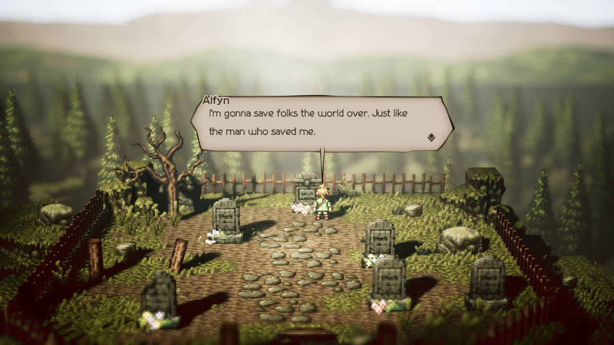
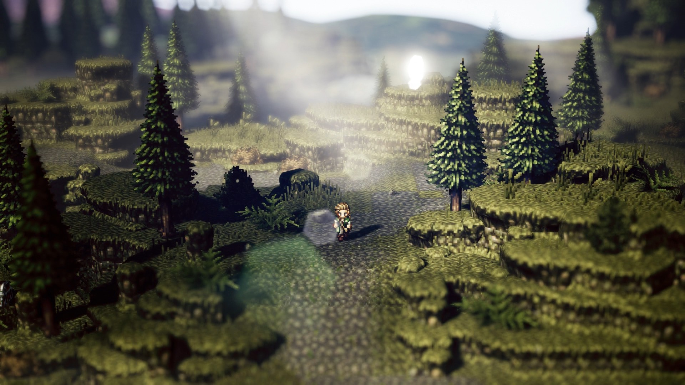
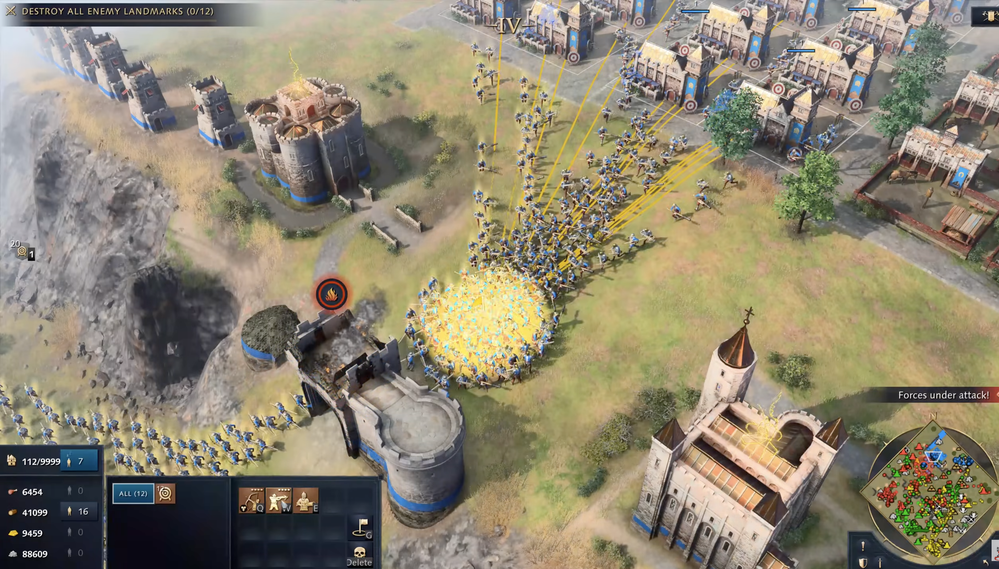

# Sovereign Realms — Design & Implementation Plan

Status: design brief for a fresh Unreal Engine project. Updated November 12, 2026.

## Vision and current decisions

A top-down real-time strategy game inspired by LEGO Battles and Total Annihilation, with compact kingdoms, responsive armies, and an ancient fantasy world. Subtle biblical symbolism may inform the later world and heroes, including David, Solomon, and Leviathan.

Use Unreal Engine for the game and Blender for asset creation and refinement. Claude Opus 5.5 is the intended implementation assistant. Unity and C# in the original brief are superseded. No existing code or assets are assumed to transfer automatically to Unreal.

The references establish mood, spatial character, and interface organization. They are not a ceiling for quality. Aim for sharper, higher-definition environments, richer textures, refined characters, and more dimensional detail. Coarse pixelation is not mandatory. Preserve the charm of a living miniature fantasy world while improving visual fidelity.

## First playable scope

- One map.
- Two troop types, supporting multiple instances of each type. Exact troop identities remain open; a melee and a ranged type are a practical proposal, not a settled requirement.
- One buildable defensive tower type.
- Gold mines and farms automatically generate gold and food. No worker-management system.
- Grid-based construction with clear valid/invalid previews, costs, snapping, and visible construction progress.
- A simple recruitment flow for both troop types. Where recruitment occurs is still to be decided; avoid expanding the building roster just to implement it.
- Individual and group selection, responsive movement and attack commands, health, damage, and death.
- A minimal opposing force or scenario to test combat. A full strategic kingdom AI is later scope.
- A coherent, polished terrain, lighting, animation, and interface treatment within this limited map.

Refine this small playable experience before expanding troop types, maps, buildings, or systems. Heroes, cavalry, specialized units, patrol/defense behavior, advanced formations, and strategic enemy base construction belong to later phases unless explicitly brought forward.

## Visual references

These supplied screenshots are reference material, not game assets to redistribute in a shipped product. Source titles are contextual; exact original capture provenance has not been independently verified.

### A — Intimate clearing and material detail

Borrow the layered vegetation, warm directional sunlight, long shadows, weathered stone, small environmental details, and miniature-world composition. Terrain edges and props should feel deliberately placed. The parchment dialogue treatment can inform the material palette, but it is not an approved menu layout.

Improve beyond the reference: sharper materials and silhouettes, more surface detail, less coarse pixelation, and better clarity at tactical zoom. Do not reproduce its graveyard layout or dialogue content.

### B — Forest depth and mystical atmosphere

Borrow the separation of foreground, middle ground, and background; terraced terrain; mossy rock; forest silhouettes; atmospheric haze; and light through the canopy. Combine those qualities with the user's stronger golden-hour direction.

Improve beyond the reference: preserve terrain detail and readable troops; avoid washed-out highlights, distracting lens artifacts, or heavy blur over playable ground. Use fog and depth of field selectively rather than copying the image's blur literally.

### C — Menu and interface design reference

Use this as a reference for an elevated battlefield view, dimensional stone architecture, faction accents, compact settlements, and the organization of an RTS interface. The visible interface uses dark panels, restrained gold borders and headings, resource information, unit portraits/icons, contextual commands, alerts, and a corner minimap.

Adapt those principles into an original interface matching Sovereign Realms' ancient fantasy palette. Keep the battlefield dominant. Do not copy exact icons, layouts, lettering, or decorative artwork. The huge army, crowded minimap, extensive building rows, and abundant command lines in this screenshot are not MVP scope or target visual clutter.

## Art direction

A detailed miniature civilization: sandstone and weathered stone, timber, bronze, muted gold, olive greens, earthy paths, deep blue accents, fabric banners, and faction colors. Trees, rocks, roofs, armor, and terrain must share a coherent level of detail and style.

Prioritize building textures: visible stone courses, timber grain, roof variation, edge wear, material roughness, and believable contact with the ground. Avoid uniform noisy texture coverage. Distinguish major forms at distant zoom and reward closer inspection with detail.

Handcraft the map's visual composition: natural shoreline transitions, changes in elevation, purposeful paths, irregular vegetation clusters, and open combat areas. Keep compact, densely developed kingdoms within a larger battlefield, with space between opposing territories for maneuvers. Do not lock map dimensions before testing movement and camera readability.

## Lighting and effects

Target a mystical, cinematic golden hour: warm sunlight, cooler shadow tones, dimensional materials, dynamic shadows, restrained bloom, subtle atmospheric haze, and volumetric light shafts through trees. Aim for the feel of convincing ray-traced lighting without making any one rendering method a prerequisite.

Candidate Unreal systems to evaluate:

- Directional Light, Sky Light, and Sky Atmosphere for the main lighting foundation.
- Lumen for indirect light and reflections when suitable for the chosen Mac and performance budget.
- Exponential Height Fog, Volumetric Fog, or local fog for controlled mist and light shafts.
- Post Process Volume for exposure, color grading, restrained bloom, and selective depth of field.
- Niagara for chimney smoke, dust, embers, impact effects, and later magical effects.
- Appropriate materials for water movement, shore transitions, foliage, stone, wood, metal, and fabric.

These are implementation candidates, not a requirement to enable every expensive feature. Confirm support in the actual Unreal release and profile on the new Mac. Keep soldiers, projectiles, selection indicators, and construction previews readable through effects. Avoid heavy fog, excessive glare, crushed shadows, and gameplay-obscuring blur.

## Characters and animation

Each troop type needs spawning/entering play, idle, walking, attacking, taking damage, and death states. Add turning, stopping, and transitions where needed for responsive behavior. Idle includes subtle breathing or stance shifts. Ensure attacks visibly connect: align weapon contact or projectile release with damage timing and feedback.

Damage reactions should not constantly interrupt commands or lock troops into repeated flinches. Death removes combat participation reliably and has a controlled corpse/removal policy. Spawn feedback must clearly communicate when a unit becomes selectable and active. Choose the underlying 2D, 3D, or hybrid character pipeline after testing its visual quality and animation workflow; pixel sprites are not compulsory.

## Camera and interface

Use an elevated angled top-down view with smooth pan and zoom. Test character silhouettes, building proportions, targeting, and selection at both close and tactical distances. Choose camera projection based on the approved appearance and rendering behavior.

The in-game interface should reflect the world: dark blue/charcoal surfaces, restrained bronze or gold details, legible text, and clear icons are a starting interpretation of reference C, subject to review. Support gold/food counters, selection information, building controls, recruitment, contextual commands, feedback, and a useful minimap if warranted by the map. Keep panels compact and prevent text overlap or clipping.

The user supplied reference C as the menu/interface direction. Use it for the main menu, settings, and in-game HUD: dark panels, restrained gold detailing, faction accents, legible typography, and clear illustrated controls. The screenshot depicts an in-game HUD rather than a title screen; translate its visual language into an original main-menu composition rather than treating the reference as missing. No placeholder reference is needed. Present a menu mockup for layout feedback while preserving this established direction. Match the environment references in palette, atmosphere, and material finish.

## Implementation sequence and review gates

1. On the new Mac, verify available storage, memory, OS/toolchain compatibility, and a stable Unreal version. Install required engine components, templates, and starter content; add other platform targets only when needed. Configure local Claude Code and Unreal MCP, then verify editor access with a harmless read operation. Blender is part of the asset workflow; its AI integration requires separate setup.
2. Create one representative terrain corner with a tower, mine/farm samples, both troop types, and the gameplay camera. Establish materials, lighting, fog, and visual scale. Review appearance before expanding the map.
3. Show an in-game HUD mockup derived from reference C and a main-menu concept using the supplied menu/interface reference. Obtain visual direction feedback.
4. Complete the small gameplay loop: generate resources, construct, recruit, select, move, fight, take damage, and die. Test both troop types and tower behavior.
5. Integrate all animation states, audio feedback, subtle environment animation, and restrained combat effects. Review in motion rather than relying only on still screenshots.
6. Package a native Apple Silicon Mac build and test it outside the editor. Measure frame rate with a defined map, troop count, resolution, and quality preset. Smooth 60 FPS is a target, not an unverified guarantee. Choose a realistic unit-count budget through measurement.
7. Expand only after this map meets the visual and gameplay standard.

## Acceptance checks

- Both troop types can be recruited repeatedly, selected, commanded, and distinguished at tactical zoom.
- Tower placement, mine/farm output, costs, construction progress, and combat work together in the same build.
- Animations visibly communicate every core state, and damage timing matches the attack presentation.
- Terrain and buildings reward close inspection without repetitive visual noise.
- Golden-hour lighting, shadows, mist, and light shafts add depth without hiding gameplay.
- UI stays legible and does not overlap or obstruct essential controls across the intended resolutions.
- A standalone Mac build works and performance is measured on the actual target hardware.

## Open decisions

Exact troop identities; recruitment location; opposing-force and victory rules; final character rendering approach; main-menu layout details; map dimensions; target battle size; new Mac specifications; final engine version and quality settings.

Architecture choices remain flexible. Claude may propose technical approaches based on the actual project, but should preserve the agreed MVP scope and distinguish proposals from user-approved decisions.
